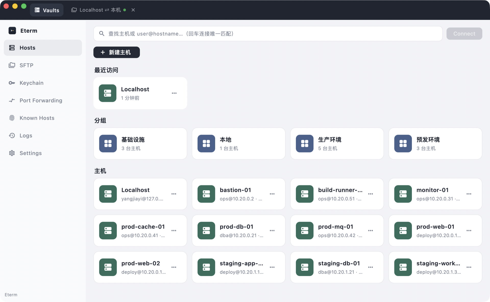
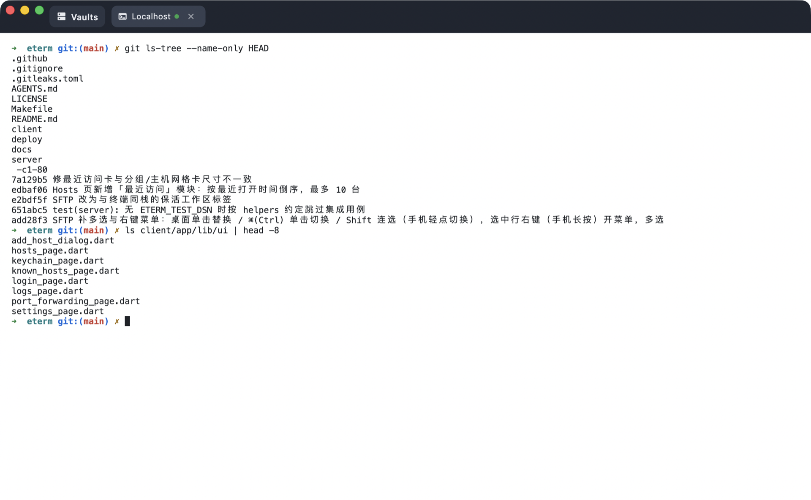
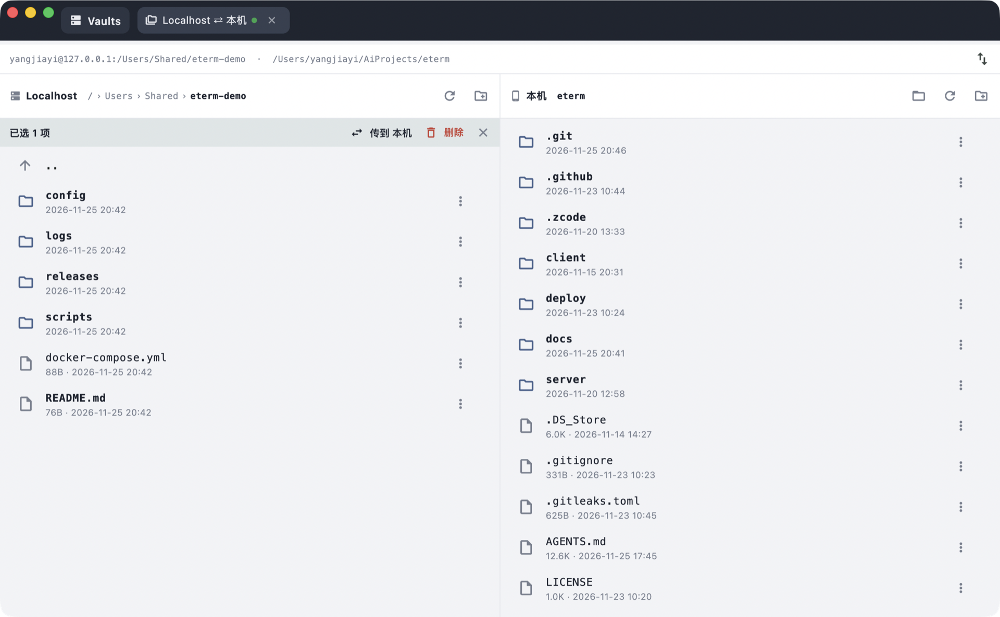
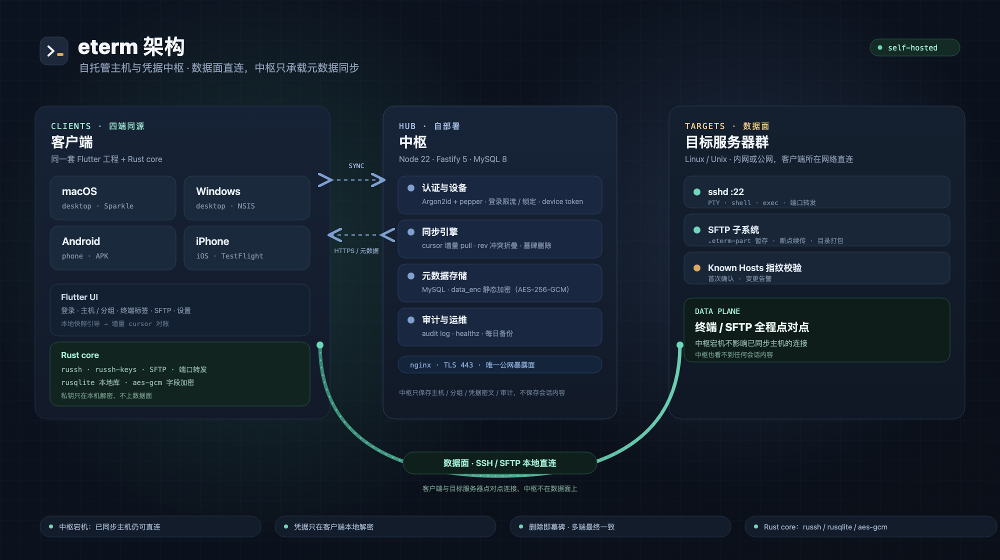

<p align="center">
  
</p>

<h1 align="center">eterm</h1>

<p align="center">
  <strong>自托管的主机与凭据数据中枢</strong><br/>
  一次部署，四端同步。SSH / SFTP 由客户端直连目标服务器，中枢永远不在数据面上。
</p>

<p align="center">
  <a href="LICENSE"></a>
  <a href="https://github.com/DC-ET/eterm/actions/workflows/ci.yml"></a>
</p>

<p align="center">
  <a href="#快速开始">快速开始</a> ·
  <a href="#多端接入">多端接入</a> ·
  <a href="#架构概览">架构概览</a> ·
  <a href="docs/eterm-产品设计与需求文档-v2.md">产品设计</a> ·
  <a href="docs/plan/eterm-技术方案.md">技术方案</a> ·
  <a href="docs/eterm-发布流程.md">发布流程</a>
</p>

<p align="center">
  
</p>

<p align="center">
  
</p>

<p align="center">
  
</p>

---

大多数 SSH 工具是为个人设计的：主机清单存在各自的电脑里，私钥散落在不同目录，换台设备或换个人就得重新配一遍。

**eterm 把「主机与凭据」当作基础设施来管理。** 服务器账号、私钥、分组与端口转发规则集中在一台你**自己部署**的中枢里；macOS、Windows、Android、iPhone 客户端同步后，用各自所在的本地网络**直连目标服务器**。中枢只承载元数据同步，既不解密会话，也不中转流量。

## 为什么用 eterm

- **数据面直连，中枢不在链路上** — 终端、SFTP、端口转发全部由客户端 Rust core（russh）与目标服务器点对点完成。中枢宕机不影响已同步主机的连接，中枢也看不到任何会话内容。
- **一次部署，四端同步** — 主机、分组、身份、密钥、端口转发规则经增量 cursor 同步；冲突按 `rev` 折叠，删除走墓碑，多端最终一致。
- **凭据集中托管** — 口令与私钥随中枢跨设备同步；服务端 `data_enc` 静态加密（AES-256-GCM），客户端本地库字段级加密，私钥只在客户端本地解密。内置 Keychain 支持导入、生成 Ed25519/ECDSA/RSA 密钥，并可一键把公钥部署到目标机。
- **完整的 SSH 工作流** — PTY、多标签、断线重连、端口转发，以及 Known Hosts 指纹校验（首次确认、变更告警）。
- **SFTP 双栏工作区** — 任意两端互传（远端 ⇄ 本机、远端 ⇄ 远端）；多选、拖放、跨会话传输队列；`.eterm-part` 暂存与断点续传；目录自动打包为 `.tar.gz` 下载。
- **克制的安全基线** — Argon2id + pepper 口令哈希、登录限流与失败锁定、设备 token 可撤销、审计日志、CI 全树密钥泄露扫描。
- **多端分发与自动更新** — macOS 走 Sparkle EdDSA 签名更新，Windows 为 NSIS 安装包，Android 支持应用内 OTA，iOS 经 TestFlight 分发；build 号是唯一权威。
- **完全自托管，无 SaaS 依赖** — MIT 协议，nginx + systemd + MySQL 即可上线；服务端全部配置经环境变量注入。

## 多端接入

同一套 Flutter 工程与 Rust core，按场景选择入口：

| 端 | 适用场景 | 分发 / 更新 |
|----|----------|-------------|
| **macOS 桌面** | 日常运维、多标签终端、SFTP 双栏、拖放传输 | ZIP + Sparkle EdDSA 应用内更新 |
| **Windows 桌面** | 同上的桌面体验，原生窗口控制 | NSIS 安装包 + 应用内更新 |
| **Android** | 移动查看主机、应急终端、SFTP 传文件 | APK + 应用内 OTA |
| **iPhone** | 移动办公与随身高频操作（锁竖屏，单列布局） | TestFlight（Apple 托管） |

四端共享 `client/app/lib` 与 `client/app/rust`；平台差异只落在窗口管理、文件保存、后台挂起策略等薄层。桌面使用侧栏 + 网格布局，手机（宽度 < 720）切换为底部导航 + 单列卡片 + FAB。

## 架构概览

<p align="center">
  
</p>

**两条铁律：**

1. **数据面直连** — 终端与 SFTP 由客户端内的 Rust core（russh）直接连接目标服务器。中枢宕机不影响已同步主机的连接，中枢也不参与任何会话流量。
2. **同步面最小化** — 中枢只保存实体元数据：主机、分组、身份、密钥、端口转发规则与审计记录。实体 `data_enc` 静态加密；凭据解密发生在客户端本地。

技术栈：中枢为 **Node 22 + TypeScript + Fastify 5 + MySQL 8**；客户端为 **Flutter 3.50 + Rust core**（russh 0.46、rusqlite、aes-gcm，经 flutter_rust_bridge 2.13 暴露）。同步采用 cursor 增量拉取，客户端把变更折叠进本地库后重建视图。

## 快速开始

### 中枢（服务端）

环境要求：Node.js 22+、MySQL 8.x。

```bash
cd server
export ETERM_MASTER_KEY=$(openssl rand -base64 64)   # 解码后须 64 字节
export ETERM_PEPPER=$(openssl rand -hex 32)
export ETERM_DB_DSN='user:pass@tcp(127.0.0.1:3306)/eterm?parseTime=true&multiStatements=true&loc=UTC'

npm ci
npm run migrate       # 执行数据库迁移
npm run create-user   # 创建首个账号（交互式；--stdin-password 可非交互）
npm run dev           # 默认监听 127.0.0.1:8080
```

生产环境把 nginx 放在最前面终结 TLS，中枢只监听回环地址；样例见 [`deploy/`](deploy/)：`nginx-example.conf`、`eterm.service`、`eterm.env.example`、`backup.sh`。完整上线步骤见 [发布流程](docs/eterm-发布流程.md)。

### 客户端

环境要求：Flutter 3.50.x、Rust stable，以及各端工具链（Xcode 26+ / VS 2022「使用 C++ 的桌面开发」/ Android SDK）。

```bash
cd client/app
flutter pub get
(cd rust && cargo test --lib)   # Rust core 测试
flutter analyze                 # 必须 0 error
flutter run                     # 选择 macOS / Windows / Android / iOS 设备
```

首次启动在登录页填入**你自己的中枢地址**（「服务器地址」要求 `https://`；客户端不预填任何默认地址）。

## 仓库结构

```
server/          中枢服务端（Node 22 + TypeScript + Fastify 5 + mysql2）
  src/           auth / syncstore / syncengine / crypto / API
  migrations/    DDL 迁移
client/app/      Flutter 客户端 + Rust core（frb 2.13 暴露）
  lib/           Dart UI / services（同步、终端、SFTP、更新、设置）
  rust/          russh SSH 数据面 / rusqlite 本地库 / aes-gcm / keychain
  scripts/       四端发布脚本（服务器信息全部走环境变量）
deploy/          nginx / systemd / 备份 / 环境变量样例
docs/            PRD、技术方案、评审记录、发布流程
```

## 部署与发布

发布脚本不内置任何服务器信息，全部经环境变量注入：

```bash
export ETERM_SERVER=root@your-server-ip            # 或 user@host
export ETERM_SSH_KEY=~/.ssh/your-server.pem
export ETERM_REMOTE_DIR=/opt/eterm
export ETERM_UPDATE_BASE_URL=https://hub.example.com/updates
export ETERM_SPARKLE_PRIVATE_KEY=~/.ssh/eterm-sparkle-ed25519   # 仅 macOS
```

- **macOS**：`client/app/scripts/release_macos.sh`（bump → 打包 → Sparkle 签名 → 上传）
- **Android**：`client/app/scripts/release_android.sh`（产物 sha256 双端校验）
- **iOS**：`client/app/scripts/release_ios.sh`（须 ASC API Key；`--no-upload` 可本地演练）
- **Windows**：`client\app\scripts\release_windows.ps1`（必须在 Windows 机上执行）

四端的版本 bump、build 号单调性与发布口径保持一致，详见 [发布流程](docs/eterm-发布流程.md)。客户端应用内更新源同理：构建时 `--dart-define=ETERM_UPDATE_BASE_URL=...`，未注入即关闭更新检查。

## 验证与测试

提交前本地全绿；CI（GitHub Actions）对每个 push / PR 执行：

```bash
# 服务端（CI 附带 MySQL 8 service）
cd server && npm run typecheck && npm test

# 客户端（四端共享 Dart 代码）
cd client/app && flutter analyze && flutter test

# Rust core
cd client/app/rust && cargo test --lib

# 密钥泄露扫描（当前树）
gitleaks detect --no-git --config .gitleaks.toml
```

## 文档索引

- [产品设计与需求文档 v2](docs/eterm-产品设计与需求文档-v2.md)
- [技术方案总览](docs/plan/eterm-技术方案.md)
- [SFTP 工作区标签技术方案](docs/plan/eterm-SFTP工作区标签技术方案.md)
- [Windows 客户端技术方案](docs/plan/eterm-Windows客户端技术方案.md) / [iOS 客户端技术方案](docs/plan/eterm-iOS客户端技术方案.md)
- [自动更新方案](docs/plan/eterm-自动更新方案.md) / [上线交接](docs/plan/eterm-自动更新上线交接.md)
- [发布流程](docs/eterm-发布流程.md)
- [AGENTS.md](AGENTS.md)：面向 AI 协作代理的项目约定与踩坑记录

## 安全提示

- 本项目用于**自托管**场景。暴露到公网前请自行评估：TLS 证书、防火墙（仅 443 + SSH 管理口）、MySQL 绑定地址、备份加密与轮换。
- **信任模型的核心是「中枢不在数据面上」**——请勿修改架构让中枢代连目标服务器或中转会话流量。
- 发现安全问题请勿直接开公开 issue，先私下联系维护者。

## 参与贡献

欢迎提交 [Issue](https://github.com/DC-ET/eterm/issues) 与 Pull Request。提交前请阅读 [AGENTS.md](AGENTS.md)（多端一致性规范、wire 契约与已知陷阱），并确保上述本地门禁全绿；涉及客户端共享代码的改动需按全端验证。

> 说明：本项目采用 MIT 协议开源，仅提供源码与自托管文档，不提供官方 SaaS 托管服务。生产环境部署前请充分评估安全与合规边界。

## 许可证

[MIT License](LICENSE) © 2026 eterm Contributors